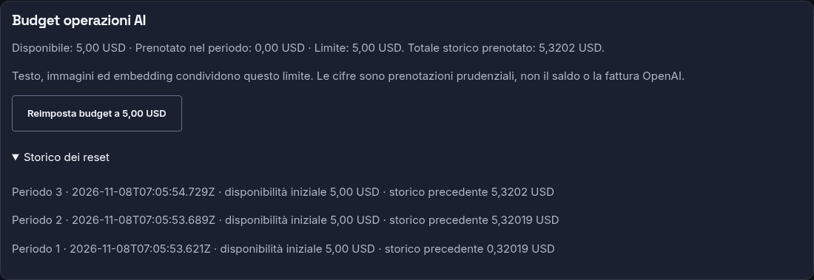
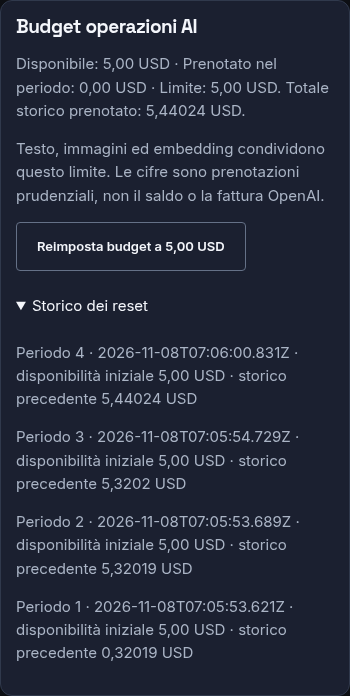

# Budget AI in dashboard — 1.0.0

Aggiornato: 2026-11-08T07:01:53Z. Base main `7975604`, app 0.20.0,
contratto canonico 12.0.0, migrazione additiva 0027. Richiesta dell'owner:
pulsante di reset e 5 USD aggiuntivi. Questa decisione sostituisce la scelta
del budget ancora pendente nella documentazione 11.0.0.

## Comportamento

La dashboard `/admin` mostra disponibilità, importo prenotato nel periodo,
limite e totale storico. Testo, generazione immagini ed embedding consumano
un'unica disponibilità; non ci sono tre crediti cumulabili da 5 USD. I valori
sono stime prenotate prima delle chiamate, non consumi effettivi certificati
dal provider. Gli esiti incerti rimangono prenotati.

«Reimposta budget a 5 USD» richiede conferma e apre un nuovo periodo da 5 USD:
il residuo precedente viene sostituito, non sommato. La dashboard mostra gli
ultimi dieci reset. Il reset non ricarica l'account OpenAI, non cancella le
spese precedenti e non avvia modelli, ricerca, embedding o pubblicazione.
È disponibile senza tema selezionato e anche con i gate AI spenti, purché
l'importo di reset sia configurato sul server.

I limiti monetari totali, giornalieri e per-run si riferiscono al periodo
attivo; i conteggi di chiamate/generazioni e le chiavi delle operazioni restano
storici. Il reset non consente di ritentare una richiesta incerta, riusare
una variante SLOP congelata o bypassare un limite di generazioni.

## Persistenza e API

La migrazione 0027 aggiunge `editorial_budget_periods` e
`editorial_budget_allocations`, entrambe immutabili. Non crea un periodo
automatico e non modifica le righe esistenti. La view `editorial_budget_current`
seleziona l'ultimo periodo; `editorial_budget_usage` seleziona le prenotazioni
assegnate a quel periodo, o l'intero ledger se nessun reset è mai avvenuto.

Un trigger assegna atomicamente ogni nuova prenotazione al periodo corrente;
un altro impedisce il superamento del cap comune, anche per i producer legacy
Batch/v2. Il collegamento usa ID persistenti, mai rowid impliciti o timestamp:
il ripristino di un export conserva l'appartenenza e il budget. REAL Discovery
e memoria semantica usano lo stesso periodo nei controlli economici.

`POST /api/admin/editorial/intelligence/budget/reset` richiede autenticazione
admin e la protezione di origine già esistente. Corpo esatto:

```json
{"operation_id":"UUID","expected_period_id":null,"amount_usd":5}
```

`null` è ammesso soltanto prima del primo periodo. L'importo deve corrispondere
esattamente a `EDITORIAL_BUDGET_RESET_USD`, senza possibilità di aumentarlo
dal browser. L'inserimento condizionale confronta il periodo atteso con quello
corrente, registra il totale storico di partenza e controlla che non ci siano
chiamate preparate/in invio o embedding in invio. Una richiesta concorrente
o una scheda vecchia riceve 409. Lo stesso ID e payload restituiscono la ricevuta
precedente; un ID riutilizzato con parametri differenti non crea altro credito.
La UI blocca gli invii durante l'operazione e rilegge lo stato dopo un errore,
senza ripetere automaticamente il reset.

## Configurazione e rilascio

La richiesta corrente autorizza implementazione, merge dopo test/anteprima/CI,
migrazione, rilascio e disponibilità iniziale di 5 USD aggiuntivi. Conservare
backup D1/R2, sorgente Worker e ricevuta privata. Applicare 0027 dopo una prova
di ripristino su backup fresco; prima di abilitare i gate registrare il primo
periodo con i 0,50 USD residui più i 5 USD aggiuntivi: 5,50 USD disponibili,
a fronte di 4,50 USD storici prenotati (tetto cumulativo 10 USD). Nessuna inferenza reale per
collaudare questa modifica e nessun backfill del tema pending.

Configurazione owner-first iniziale:

| Variabile | Valore |
| --- | --- |
| `EDITORIAL_BUDGET_RESET_USD` | `5` |
| `WORKSPACE_AI_ENABLED`, `ENABLE_REAL_DISCOVERY_PAID` | `true` |
| `REAL_DISCOVERY_MODEL` | `gpt-6.1-terra` |
| `REAL_DISCOVERY_CALL_USD` | `0.5` |
| `REAL_DISCOVERY_RUN_USD`, `REAL_DISCOVERY_DAILY_USD`, `REAL_DISCOVERY_TOTAL_USD` | `5.5` |
| `REAL_DISCOVERY_MAX_CALLS` | `100` |
| `ENABLE_EDITORIAL_CYCLE_GENERATION` | `true` |
| `EDITORIAL_CYCLE_IMAGE_MODEL` | `gpt-image-1.5` |
| `EDITORIAL_CYCLE_GENERATION_USD`, `EDITORIAL_CYCLE_MAX_GENERATIONS` | `2`, `8` |
| `TOPIC_EMBEDDING_MODEL` | `text-embedding-3-small` |
| `TOPIC_EMBEDDING_CALL_USD` | `0.001` |
| `TOPIC_EMBEDDING_DAILY_USD`, `TOPIC_EMBEDDING_TOTAL_USD` | `5.5` |

La credenziale server è già configurata. I gate legacy e lo stato persistente
di Topic Discovery non vengono attivati dal rilascio: l'owner sceglie quando
richiedere le operazioni. Nessun cron o modifica alla #76. La qualità delle
proposte resta da valutare su un corpus rappresentativo.

## Verifica

Test unitari di autenticazione/origine/metodo/input; SQLite per upgrade
conservativo, immutabilità, budget comune e rollback dei trigger Batch,
replay e dump/restore. Il vero Worker con D1/R2 e provider fittizi verifica
reset concorrenti, schede obsolete, chiamate in corso, limite condiviso,
embedding pending a budget esaurito e indicizzazione dopo il reset. Browser
desktop/mobile: annullamento, conferma, persistenza al refresh, storico e
assenza di overflow, oltre al ciclo editoriale già coperto.



