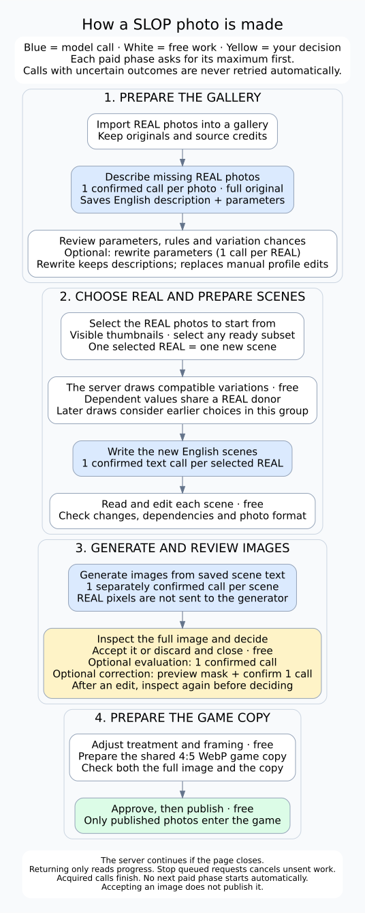

# Generazione SLOP — specifica 17.2.0

Aggiornata: 2026-11-26T06:27:12Z. Stato: implementata nel ramo 1.62.0, da rilasciare.

Schema vettoriale in `docs/assets/pipeline-slop.svg`, sorgente Graphviz in `docs/assets/pipeline-slop.dot`; copia pubblica
identica in `public/docs/pipeline-slop.svg`, collegata dal wizard.

Decisione dell’owner del 2026-11-25: tutta l’interfaccia amministrativa è in inglese, incluse gallerie, wizard REAL, pipeline SLOP, assi, parametri, conferme, errori, statistiche, impostazioni e schema della pipeline. I nuovi testi dei modelli sono in inglese; le scritte visibili nelle foto si trascrivono nella lingua originale. Titoli, descrizioni delle fonti, regole personalizzate e dati storici conservano la lingua salvata. Il sito pubblico resta in italiano.

## 1. Obiettivo e stato dell'implementazione

Decisioni dell'owner del 2026-11-24 e 2026-11-25: generare fotografie che sembrino appartenere alla galleria delle REAL,
partendo dalle loro descrizioni testuali in inglese. La varietà comprende elementi nuovi ma plausibili e combinazioni ordinarie.
Evitare copie riconoscibili delle REAL e tratti ricorrenti che distinguano il dataset SLOP, per esempio usura sempre accentuata,
edizioni speciali troppo frequenti o composizioni commerciali sistematiche.

La 1.60.0 sostituisce i controlli del wizard della galleria con il protocollo qui descritto. Una selezione iniziale comprende
tutte le REAL della galleria fuori dal cestino. Le vecchie API e i processi editoriali restano compatibili per i dati precedenti;
un riquadro di recupero mostra i processi precedenti ancora da decidere. Il nuovo wizard non usa il vecchio ciclo automatico.

Le migrazioni 0073 e 0074 aggiungono profili e scene privati su `images`, impostazioni su `galleries` e `pipeline_jobs` temporanei.
Ogni lavorazione ha un Workflow e uno stato persistente. Una conferma acquisisce una sola operazione; il Workflow non ritenta
passi a pagamento. La coda acquisisce al massimo tre operazioni contemporanee. Le richieste ancora in attesa si possono annullare gratuitamente;
quelle già inviate terminano senza avviare altre fasi. Dopo quindici minuti una richiesta acquisita senza esito passa all'attenzione dell'owner, senza reinvio automatico.

### Comandi e conferme

- **Prepara la galleria:** una chiamata per REAL ancora priva di profilo, su originale intero. Salva descrizione inglese,
  identità, genere, parametri osservati e particolarità. Riusa i profili già presenti. I dati sono rivedibili senza chiamate.
- **Indicizza gli ambienti:** riusa il comando degli indici 1.59.0, con massimo dinamico, mantenendo gli esiti riusciti.
- **Regole e probabilità:** modificabili per galleria. Ogni probabilità vuota usa la stima automatica; zero disabilita un controllo.
  L'ambiente può restare invariato, variare entro lo stesso genere o cambiare insieme al genere.
- **Prepara scene:** una chiamata per REAL selezionata e preparata. Le estrazioni e i riferimenti vengono congelati. Sono
  mostrate le modifiche e le dipendenze. L'owner modifica i campi della scena, il formato e i parametri previsti senza pagare.
- **Genera:** una chiamata per scena salvata, anche collettivamente dopo conferma del massimo. Una candidata non è accettata
  dal modello: resta da vedere. **Valuta** è una fase confermata separata, una chiamata per candidata, disponibile anche in gruppo.
- **Correggi:** ogni proposta apre un'anteprima della maschera sull'immagine intera, con benefici e rischi e zona rettangolare
  modificabile. Solo la conferma finale autorizza una chiamata a `images/edits`. La valutazione precedente resta visibile;
  nessuna valutazione aggiuntiva viene avviata. Il prima/dopo viene conservato fino alla decisione.
- **Accetta:** trasferisce l'immagine intera nella libreria come nuova. Elimina il riferimento alla REAL e i file temporanei
  mediante coda durevole. L'accettazione non prepara, approva o pubblica la copia automaticamente.
- **Copia, trattamento, approvazione e pubblicazione:** comandi distinti, gratuiti. La misura tecnica delle copie REAL mancanti
  è calcolata dal browser. Il riferimento del trattamento è campionato fra REAL misurate dello stesso genere di destinazione;
  senza riferimento disponibile la copia parte senza trattamento. Inquadratura e cursori riusano gli editor esistenti.

API private: `GET /api/admin/pipeline/:gallery`; `POST /:gallery/settings`, `/profile`, `/prepare`, `/index`, `/plan`, `/stop`;
`POST /:gallery/:job/{scene,generate,evaluate,edit,accept,close}`; `GET /:gallery/:job/file` e `?previous=1`.
Le fasi a pagamento richiedono `confirm`, UUID `request` e `max_calls` esatto. Dal 2026-11-26 la preparazione accetta fino a 5000 REAL in una richiesta: tutta la selezione viene accodata atomicamente prima dell’avvio, senza dipendere da una successione di richieste del browser. Lo stesso comando prepara descrizioni e profili da Import REAL, galleria e dettaglio. `GET /api/admin/pipeline/:gallery/descriptions` espone l’avanzamento senza i profili completi. Il planner conserva il limite di 500 scene per richiesta, con suddivisione delle selezioni maggiori entro il massimo confermato.
Modelli e qualità sono quelli selezionati nelle Impostazioni; il selettore include GPT-6.2 Sol e Sunburst.

## 2. Descrizioni, assi e regole della galleria

Il modello descrive l'originale REAL **intero**, prima di ritaglio e trattamento, su otto assi:
`subject_type`, `subject_appearance`, `people`, `environment`, `viewpoint`, `light`, `technique`, `rendering`.
La descrizione è privata, in inglese, distinta da quella Commons. Si prepara al caricamento o successivamente in gruppo;
una REAL senza descrizione è segnalata sulla miniatura (specifica `libreria-immagini`).

Descrivere una singola scena fotografica: soggetti, superfici visibili, posa e sostegni, fotocamera, ambiente, luci, ombre,
fuoco, medium e resa. Le parti nascoste del prodotto non diventano oggetti da mostrare. Distinguere osservazioni, inferenze
e dettagli non determinabili. Trascrivere le scritte leggibili nella lingua originale: conservarle nell'analisi non significa
che debbano essere riprodotte nella SLOP.

Le regole della galleria accompagnano il generatore di testo: modelli compatibili, vincoli fisici e generi fotografici presenti.
Per Nintendo: `docs/regole-galleria-console-nintendo.md`. Sono costruite sulle REAL, rivedibili dall'owner, non dedotte dal solo
titolo. Non impongono marcatori visivi comuni a ogni SLOP. Nel planner attuale l’indice semantico degli ambienti cerca fino a tre riferimenti simili se l’ambiente si conserva, diversi se cambia. Le corrispondenze vengono poi confrontate per modello nei profili e filtrate per genere, quando richiesto. Gli indici esatti di marca, famiglia e modello servono alla ricerca privata, ma il planner non li usa come filtri SQL. Senza embedding disponibili il planner ripiega sui profili già preparati: gli indici sono quindi un aiuto opzionale al recupero del contesto, non scelgono la REAL iniziale né regolano probabilità e variazioni. La preparazione iniziale di una REAL non consulta più gli indici. Le statistiche usano le annotazioni disponibili.

## 3. Parametri controllabili

Gli assi restano la struttura della descrizione finale. I parametri definiscono cosa variare separatamente, rispettando le
dipendenze fisiche e storiche. La tabella specializza il protocollo per Nintendo; altre gallerie richiedono parametri pertinenti.

| Parametro | Significato | Asse principale |
|---|---|---|
| `model` | Famiglia e modello della console | `subject_type` |
| `colour` | Colore della scocca e dei componenti | `subject_appearance` |
| `material_finish` | Materiale, opacità, trasparenza e finitura | `subject_appearance` |
| `edition_decoration` | Edizione, personalizzazione, grafiche e adesivi | `subject_appearance` |
| `wear` | Abrasione, graffi da uso, superfici lucidate dal contatto | `subject_appearance` |
| `damage` | Fratture, scheggiature, deformazioni e parti mancanti | `subject_appearance` |
| `ageing` | Ingiallimento, scolorimento, ossidazione e deterioramento nel tempo | `subject_appearance` |
| `cleanliness` | Polvere, impronte, sporco e residui rimovibili | `subject_appearance` |
| `operating_state` | Accesa/spenta; configurazione aperta/chiusa quando applicabile | `subject_appearance` |
| `screen_content` | Gioco/applicazione, schermata, testi, valori e disposizione visibili | `subject_appearance` |
| `pose` | Posizione e orientamento del soggetto rispetto al piano e al sostegno | `viewpoint`, con vincoli di `environment` |
| `viewpoint` | Posizione e angolo della fotocamera rispetto al soggetto | `viewpoint` |
| `composition` | Distanza, dimensione nel fotogramma, decentramento e taglio | `viewpoint` |
| `aspect_ratio` | Rapporto larghezza/altezza del fotogramma intero, con orientamento verticale/orizzontale/quadrato | `viewpoint`, coordinato con `technique` |

Il contenuto dello schermo è distinto da acceso/spento. Un menu può cambiare mantenendo la console accesa. Gioco, schermata e
dati di salvataggio devono essere plausibili per modello ed epoca. A schermo spento o nascosto, `screen_content` è non applicabile:
estrarlo non accende la console e non cambia implicitamente l'inquadratura. Se non estratto, il contenuto può restare quello
descritto; dati identificativi copiati sono comunque un rischio di eccessiva somiglianza da segnalare alla revisione.
Non imporre che ogni schermo cambi sempre, creando un'altra regolarità sistematica.

Il rapporto d'aspetto è un parametro distinto dalla composizione. Annotarlo dalle dimensioni dell'originale intero dopo
l'orientamento EXIF, prima del ritaglio 4:5. Se non estratto, conservarlo; se estratto, scegliere un valore compatibile con
soggetto, posa e genere fotografico. Bilanciare le frequenze tenendo conto di queste relazioni: console e generi diversi
possono avere formati diversi. Evitare un formato SLOP uniforme imposto per comodità tecnica.

Il rapporto scelto deve essere coerente sia nel prompt sia nelle dimensioni richieste all'API. Se l'API non lo supporta,
segnalare l'approssimazione e registrare rapporto richiesto ed effettivo; non sostituire silenziosamente un verticale con
un orizzontale né tagliare parti fondamentali per adattarlo. La copia di gioco resta 4:5 per REAL e SLOP: `aspect_ratio`
controlla la fotografia intera e non cambia il formato comune servito durante la partita.

Quando si conserva il punto di vista, mantenere anche distanza e resa prospettica compatibili. Una prospettiva meno accentuata
può suggerire una fotocamera più lontana, con focale maggiore per un'inquadratura simile, ma non dimostra una focale precisa.
La prospettiva dipende dalla posizione della fotocamera; cambiare solo focale dalla stessa posizione cambia l'inquadratura.
Descrivere l'effetto visibile e le dipendenze senza inventare dati ottici o EXIF della REAL.

Le annotazioni devono essere atomiche: il colore non include accessori, la composizione non sostituisce lo sfondo, la posa non
importa il piano d'appoggio del donatore. Usura, danno, invecchiamento e pulizia hanno valori separati, compresa assenza e non
determinabile. Un valore ignoto non prova l'assenza di un fenomeno. Persone, accessori e numero dei soggetti non diventano nuove
variazioni attive in questo test. I profili sono JSON privati validati, salvati in `images.pipeline_profile`; i controlli sono definiti in `shared/pipeline.ts`.

## 4. Estrazione e bilanciamento

Estrarre **zero o più parametri**, ciascuno con probabilità configurabile per galleria. Distinguere la probabilità di modificarlo
dalla distribuzione del nuovo valore: include valori ordinari, assenza del tratto e valori uguali al punto di partenza.
Modificare non significa intensificare: una console danneggiata può diventare integra, una personalizzata può diventare standard.
Non forzare almeno una modifica vistosa.

Probabilità e valori devono riflettere la composizione delle REAL della galleria, considerando visibilità, dati ignoti e
compatibilità con il soggetto. Il generatore di testo può proporre valori plausibili non presenti nelle REAL (un altro colore,
tema o danno), senza sovrarappresentare le novità. Il protocollo non si limita a permutare elementi esistenti.

Controllare distribuzioni individuali, combinazioni rilevanti e ricorrenze nelle SLOP: campionare i valori indipendentemente non
conserva tutte le correlazioni delle REAL. Evitare duplicati riconoscibili lasciando che gli elementi comuni nelle REAL siano
comuni anche nelle SLOP; non imporre unicità a ogni immagine. Scartare o adattare un valore incompatibile dichiarandone il motivo,
senza introdurre modifiche nascoste degli altri parametri. La stima automatica di selezione per parametro è `clamp(1 − quota_della_categoria_più_frequente, 0.05, 0.4)`.
I valori vengono campionati dalle REAL compatibili (modello o genere quando necessario), con pesi da 0.25 a 4 per compensare
sotto/sovrarappresentazione nei parametri previsti delle SLOP accettate e prior proporzionale alle REAL. Non si presume una
misura osservata delle SLOP: le distribuzioni mostrate sono quelle richieste. Il controllo delle combinazioni è affidato ai
vincoli del planner, a pochi profili recenti e alla revisione umana; non è una garanzia statistica o un rilevatore di duplicati. Questi controlli non autorizzano cicli automatici di correzione delle immagini.

## 5. Scena finale e generazione

1. Scegliere le REAL descritte e recuperare annotazioni, statistiche e regole pertinenti della galleria.
2. Registrare per il batch probabilità, estrazioni, valori e revisioni delle descrizioni e delle regole usate.
3. Il generatore di testo riceve descrizione di partenza, parametri selezionati, valori e vincoli. Produce una scena completa
   in inglese su tutti gli assi e, separatamente, i cambiamenti effettivi e gli adattamenti di compatibilità.
4. In modalità `keep`, conservare **ambiente e configurazione fisica della luce**, medium e resa fotografica. Ombre, riflessi e superfici visibili
   si adattano a nuova geometria, materiali e fotocamera. Un cambio di composizione non autorizza uno sfondo nuovo. I parametri
   non estratti conservano il valore iniziale salvo le dipendenze necessarie dichiarate. `same_genre` può cambiare ambiente e
   luce conservando il genere; `change_genre` coordina anche tecnica, resa, composizione, posa, formato e persone necessarie.
   Le dipendenze devono essere esplicite e rispettare il soggetto e le regole sui contenuti.
5. L'owner può rivedere scena e prompt prima della conferma a pagamento. Generare con `POST /v1/images/generations` passando
   **solo la descrizione testuale finale**, senza la REAL, maschere o collage. Descrivere positivamente la scena di arrivo,
   senza rimandi alla foto originale.
   Impostare le dimensioni API in base a `aspect_ratio` per ogni candidata; controllare il rapporto restituito prima della revisione.
6. Conservare la candidata intera per valutazione e decisione dell'owner. Preparare la copia di gioco dopo l'accettazione.

Modelli usati negli esperimenti: GPT-6.2 Sol (`gpt-6.2-sol`) e GPT Image 2.6 Sunburst (`gpt-image-2.6-sunburst`). I modelli restano
configurabili. Questa decisione non sceglie un modello valutatore specifico; deve poter esaminare immagini intere e vincoli.

## 6. Valutazione e correzioni con conferma

Il modello valutatore riceve la **SLOP intera**, scena/prompt di arrivo, parametri e regole pertinenti. Esamina credibilità
fotografica, geometria e dettagli, coerenza della scena e aderenza ai parametri. Può segnalare ricorrenze nel contesto fornito,
ma non dedurre la distribuzione dell'intero dataset da una sola immagine. Verificare il rapporto del fotogramma e gli
scostamenti di distanza/resa prospettica quando questi parametri devono restare vincolati.

Per gli oggetti riconoscibili dare priorità ai dettagli hardware visibili: geometria, posizione e dimensione di slot/cartucce,
porte, cerniere e comandi rispetto al modello previsto. Distinguere un errore strutturale dalle piccole variazioni di una
grafica decorativa: nel test SP Tribal l'owner considera queste ultime meno gravi. Un giudizio positivo del valutatore
non dimostra l'assenza di errori hardware; l'owner può segnalare difetti mancati senza alterare la valutazione originale.

Restituisce difetti e incertezze, con eventuali proposte di correzione: problema visibile, zona, istruzione locale, beneficio
atteso e rischio di alterare dettagli corretti. Spiega perché l'intervento potrebbe valere una chiamata. La proposta non avvia
correzione, rigenerazione o nuova valutazione.

**Ogni intervento richiede conferma dell'owner prima della chiamata a pagamento**, anche se restano chiamate nel massimo del batch.
L'owner può scegliere, modificare o ignorare le proposte, accettare la candidata o scartarla. La conferma mostra immagine, difetto,
intervento e massimo di chiamate. La conferma della generazione non autorizza le correzioni. Le valutazioni a pagamento devono
essere comprese nel massimo esplicitamente autorizzato per la fase.

La correzione approvata usa `POST /v1/images/edits` con **l'intera SLOP**, prompt locale e maschera della zona. Non passare solo
il ritaglio: il contesto completo serve per proporzioni, prospettiva e luce. La maschera è una guida e non garantisce pixel
esterni identici. Conservare e confrontare prima/dopo, mostrando anche le modifiche fuori zona. Un eventuale compositing locale
è una scelta separata e dichiarata, non una proprietà dell'API.

**Nessun ciclo automatico di valutazione/correzione e nessuna rigenerazione automatica.** Dopo l'intervento l'owner confronta
il risultato; altre correzioni o valutazioni richiedono una nuova decisione e, se a pagamento, conferma esplicita.
Una proposta del valutatore può essere inutile o peggiorare la candidata: la sua raccomandazione non autorizza la spesa.

## 7. Chiamate, dati e revisione finale

Prima di ogni fase a pagamento, confermare il massimo di chiamate includendo le valutazioni previste. Registrare modello,
richiesta, stato ed esito in `paid_calls`, senza importi. Acquisire la richiesta una volta sola; esiti incerti mai ripetuti
in automatico. La proposta del valutatore e la decisione dell'owner restano distinte.

Le descrizioni e i parametri sono privati; la scena intermedia SLOP serve al prompt e non diventa didascalia pubblica. Nei risultati
restano prompt e modello SLOP, crediti e fonte REAL. Restano validi regole sui contenuti, appartenenza alla galleria, ricetta comune
WebP 4:5 e passaggi separati di approvazione/pubblicazione. Le REAL restano giocabili. I riferimenti per la lavorazione non
introducono un registro permanente REAL–SLOP; si eliminano al termine del processo secondo le regole della libreria.

## 8. Evidenze e limiti dei test

Il 2026-11-25: quattro originali della galleria Nintendo (GBA bianco, GBC verde, SP Tribal, Game Boy bruciato). Una chiamata Sol
ha descritto le quattro REAL e annotato le 23 foto della galleria; una seconda ha preparato le scene; quattro generazioni
Sunburst hanno usato solo il testo; una correzione ha usato immagine intera e maschera. Totale 7 chiamate su 8 autorizzate.
Nessuna chiamata a un valutatore: la revisione è stata visiva. Le proposte di un modello valutatore sono una decisione successiva
dell'owner, non una funzione dimostrata da quel test.

- Contesto fotografico riconoscibile; riuscite la rimozione della decorazione Tribal e la trasformazione del Game Boy bruciato
  in GBC integro. Sol ha scartato alcune incompatibilità di posa e sfondo.
- Graffi accentuati anche con descrizioni di usura lieve: controllare questa possibile ricorrenza del generatore.
- Menu GBC riprodotto perché Sol ne aveva trascritto testo e valori: da qui `screen_content`, aggiunto dopo il test e non ancora
  sperimentato come parametro estratto.
- La correzione ha eliminato il riflesso sfaccettato della croce ma l'ha arrotondata troppo, perdendo il dettaglio centrale.
  Esito parziale, non accettato come riparazione fedele. L'immagine intera non garantisce una correzione corretta.
- Probabilità provvisoria di selezione del 30% per parametro, valori campionati dalle REAL compatibili con condizioni ordinarie
  e assenze. Non è la calibrazione finale né una dimostrazione del bilanciamento del dataset.

Artefatti locali: `artifacts/test-galleria-parametri-2026-11-25/`, ignorati da Git: catalogo/crediti, descrizioni, estrazioni,
prompt, immagini, confronti, registro locale `paid_calls` e riepilogo. Il registro non è quello di produzione. Le evidenze
essenziali sono salvate qui perché gli artefatti non sono inclusi nella PR.

### Test di cambio ambiente e revisione dell'owner

Secondo test del 2026-11-25: GBA bianco su scrivania, GBC verde sul divano, SP Tribal in una scatola di cartone. Gli ambienti
erano scelti dall'operatore; Sol ha sviluppato le scene dai testi esistenti. Una pianificazione, tre generazioni e una
valutazione Sol sulle immagini intere: 5 chiamate su 5 autorizzate, nessuna correzione. Il valutatore riceveva immagini SLOP
e descrizioni di partenza, non le foto REAL. Test del cambio ambiente entro un genere simile, non del passaggio tra generi.

Il contesto e l'appoggio sono plausibili, ma l'owner segnala un errore importante nell'alloggiamento/cartuccia del gioco
sul bordo anteriore inferiore dello SP, non rilevato dal valutatore. Il primo riepilogo dell'assistente sottostimava questo
problema. Il valutatore aveva proposto solo di attenuare un riflesso del display: non è una dimostrazione di verifica hardware
affidabile. I motivi tribali leggermente diversi sono invece giudicati meno gravi dall'owner.

L'owner osserva una resa prospettica meno accentuata della console. È compatibile con una ripresa più distante e una focale
maggiore a parità di dimensione apparente; non permette di misurare la focale dai pixel. I due originali verticali erano stati
resi orizzontali perché il client imponeva 1536×1264 a tutte le generazioni. Questo limite del test motiva il nuovo parametro
`aspect_ratio`, da applicare anche alla richiesta API. Non è una scelta autonoma del generatore di cambiare formato.

Artefatti locali in `artifacts/cambio-ambiente-stesso-genere-2026-11-25/`, ignorati da Git. La segnalazione dell'owner è
registrata separatamente da `evaluation.json`; nessuna rivalutazione o correzione a pagamento è stata avviata.

## 9. Particolarità e trattamento finale approvati

Le particolarità sono dettagli collegati ai parametri, non un nono asse o un'unica variazione generica. Ciascuna ha descrizione,
zona, parametro, ruolo (`identity`, `specimen`, `temporary`), policy (`preserve`, `vary`, `draw`) e certezza. Un nome di edizione
preciso, come GBA SP Tribal Edition, viene preferito a descrizioni generiche sostitutive delle serigrafie. La conservazione
esatta dei disegni dal solo testo non è garantita. I dati identificativi temporanei, come nome e combinazione dei progressi
in un salvataggio, vengono variati coerentemente; non si impone di eliminare sempre lo spagnolo né di spegnere tutti gli schermi.

Dopo accettazione, trattamento regolabile quando serve e preparazione comune WebP 4:5; controllo visivo finale prima di approvare
e pubblicare. Nessun rumore o sfocatura uniforme viene imposto a tutte le SLOP. Il genere di destinazione guida il campione
tecnico e non la sola REAL di partenza. Senza misure pertinenti non si inventa un trattamento.

La calibrazione è una stima iniziale esplicita, rivedibile dall'owner, da validare sulla galleria completa. Non viene promessa
l'indistinguibilità dei dataset né la rilevazione di ogni errore hardware. Le combinazioni e le ricorrenze visive richiedono
revisione. I test software usano modelli simulati; l'esecuzione sull'intera galleria reale richiede le conferme nella dashboard.

## Lingua del wizard (1.61.0)

Wizard, schema, assi e parametri sono in inglese. Anche valutazione, difetti, incertezze, benefici, rischi e istruzioni di correzione vengono richiesti in inglese, con precedenza su eventuali indicazioni linguistiche del contesto salvato. Il generatore non traduce le scritte originali citate come osservazioni. Le vecchie proposte non compaiono più sulle REAL.
