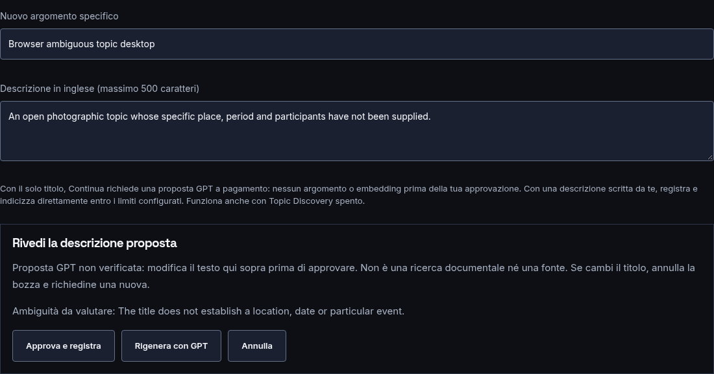
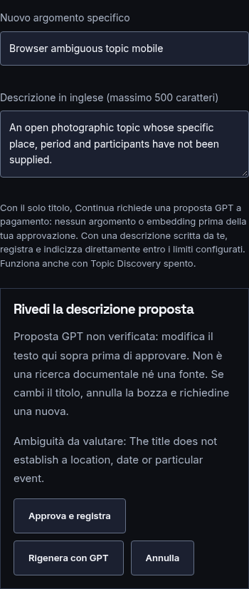

# Aggiornamento #64 / #78 — verifica 1.0.0

Aggiornato: 2026-11-07T23:14:00Z. Base: main `a10401a6c87586ef4d7517ad4f5e5e53dddad784`.
App proposta: 0.17.0. Istruzioni/mappa: 9.0.0; schema aggiuntivo: 0024.

Con il solo titolo, Continua prepara una descrizione inglese modificabile e
mostra le ambiguità. Approva e registra salva tema/testo/hash atomicamente e
poi tenta un solo embedding; Rigenera e Annulla non creano temi, vettori o seed
SLOP. Le descrizioni manuali mantengono il percorso diretto. Le bozze pronte
sono riprendibili dopo refresh e rimangono riservate all'admin.

Il server verifica ID/titolo/hash della proposta, protegge titoli normalizzati,
concorrenza e replay, rifiuta proposte annullate/sostituite e non accetta un
semplice flag di approvazione. Il trasporto comune usa una ricevuta `describe`
dedicata, gli stessi gate e il ledger REAL; risposta invalida/incerta non viene
ritentata. Costi e rigenerazioni hanno conferme esplicite nella UI. GPT assente o
budget insufficiente non fanno perdere l'input e consentono una descrizione manuale.

## Verifiche riproducibili

- `npm run lint`, `npm test`: passati, 31 file TypeScript e 258 test Python.
- `npm run build`, `npm run deploy:check`: passati. Resta l'avviso preesistente
  sulla dimensione del bundle di similarità, senza nuove dipendenze.
- Migrazione 0024 e seed sul D1 **locale**, `npm run dry-run`: passati.
- `ROS_TEST_BROWSER=1 npm run test:editorial`: passato con Worker, D1 e R2 locali
  reali e tutte le chiamate esterne intercettate da provider fittizi. Verifica
  proposta senza tema/vettore/seed, testo corretto prima della conferma, hash e
  input canonico, unico embedding, doppio clic/concorrenza, duplicati normalizzati,
  hash/titolo stale, rigenerazione idempotente, recupero da ricevuta completata,
  annullamento e conflitto con una registrazione manuale concorrente.
  Copre anche i suggerimenti storici senza descrizione: nessuna accettazione,
  mutazione di stato o chiamata a modelli può aggirare il nuovo flusso.
- Il test HTTP verifica budget esaurito, risposte invalide/incerte e mancato retry.
  Il profilo standard verifica anche gate disabilitati senza provider né tema.
- Browser Chromium a 1440×1000 e 390×844: proposta, modifica/approvazione,
  ripresa dopo reload, rigenerazione/annullamento, errore GPT e fallback manuale;
  poi il flusso fotografico già esistente fino alla pubblicazione bilanciata
  **di sole fixture locali**, nessun overflow orizzontale o errore JavaScript.
- Integrazioni generali standard, Batch, v2, senza R2, REAL e ciclo: esito
  registrato nella PR dopo la conclusione della sequenza locale.

## Anteprime

Screenshot dell'editor realmente eseguito nel browser locale. Il testo inglese
è una risposta fittizia prudente per un titolo ambiguo, non una prova pagata.

## Limiti operativi

La qualità fattuale e linguistica di un futuro provider reale richiede la
revisione dell'owner; i test simulati non la certificano. Lo storico precedente
resta leggibile e non viene reindicizzato. Gli stati preparing senza ricevuta
certa e gli uncertain rimangono bloccati; è disponibile l'input manuale.

Questa consegna non modifica produzione, secret, budget, flag, media R2 o audit
della pulizia precedente. Nessuna nuova chiamata pagata, migrazione remota, merge
o deploy eseguiti. La #76 è esclusa su richiesta esplicita dell'owner.
Specifiche e piano di rilascio: [contratto 1.0.0](topic-description-confirmation.v1.0.0.md).
