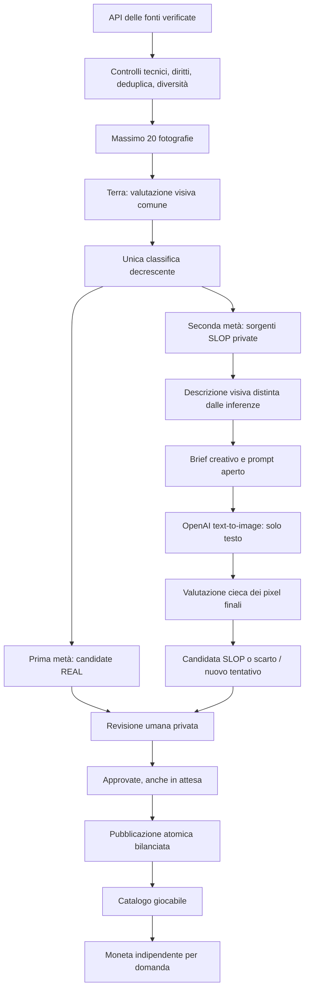

> Aggiornamento 2026-11-02T15:58:55+01:00: la revisione quotidiana usa [immagine, Approva/Rifiuta e preferenze apprese v1.0.0](revisione-visiva-preferenze-v1.0.0.md). Le schede vengono preparate prima della presentazione; i moduli precedenti restano soltanto nella gestione avanzata.

---
version: 1.0.0
created_at: 2026-11-01T22:00:00Z
status: implemented-not-activated
application: 0.11.0
---

# Pipeline editoriale REAL / SLOP

La fotografia reale è un punto di partenza concettuale. Il generatore sviluppa
un'immagine autonoma attraverso il proprio linguaggio visivo. L'interesse ludico
non coincide con la difficoltà: la qualità editoriale determina l'ammissibilità,
mentre l'eventuale difficoltà empirica sarà studiata sui comportamenti di gioco.

Questa versione sostituisce le prescrizioni su difficoltà assegnata, template
Facile/Medio/Difficile/Esperto, generazione necessariamente vincolata a un errore
e importazione delle prime fotografie tecnicamente valide nei protocolli REAL
1.0.0, SLOP 1.0.0, Studio 1.0.0 e specifiche 1.1.0. Conserva le regole sulle fonti,
sugli originali, sui diritti e sulla quarantena. Del campionamento 2.0.0 conserva
integralmente le monete indipendenti, le riserve editoriali e il preflight;
supera soltanto il filtro di difficoltà e aggiunge l'eleggibilità da pubblicazione.
I documenti precedenti e gli snapshot di audit rimangono storia del progetto.
La issue [#18](https://github.com/rickymusu-bit/real-or-slop/issues/18) è la fonte
dei criteri e della facoltatività delle note di approvazione/rifiuto.

## Componenti e confini

Si riusano Python offline/CI, i connettori ufficiali di `providers.py`,
`run.py` per download/derivati, `importer.py` per import e originali, Worker,
D1, R2, autenticazione admin, moderazione, curatela e audit. Non esiste un backend
Python nel Worker. Non si aggiungono dipendenze né servizi cloud. Le generazioni
API sono nell'esecutore privato Python, con `OPENAI_API_KEY` server-side.
Il Worker prenota budget e custodisce dati; il frontend non riceve alcuna chiave.

## Raccolta e classifica unica

`pipeline.automatic --collect` alterna cinque query tematiche e due pagine per
query, con offset giornalieri ripetibili. Esamina fino a 300 risultati per ottenere
al massimo 20 ammissibili e ammette al massimo quattro fotografie per tema.
Un tema povero non viene compensato con venti immagini dello stesso soggetto.
Il pool automatico usa un sottoinsieme conservativo di licenze già ammesse:
CC0, Public Domain Mark, CC BY 4.0 e CC BY-SA 4.0; l'importatore generale conserva
il catalogo di licenze/versioni/giurisdizioni approvato. Gli originali restano
integri, il derivato WebP conserva il fotogramma e non ritaglia crediti.

Identità provider/source ID, URL, SHA-256 di originale e derivato e dHash di
64 bit sono confrontati prima delle chiamate pagate. `collection.sqlite`
persistente evita ripetizioni locali; lo stato D1 permette deduplica anche da
esecutori nuovi. Distanza dHash ≤5 è trattata conservativamente come duplicato:
non è una prova matematica d'identità, né una certificazione di autenticità.
Le fotografie non compatibili con la natura fotografica, rilevate dall'analisi
visiva, escono dal lotto prima della classifica finale. Nessun riempitivo.

Ogni fotografia viene inviata come pixel a Responses API, con dettaglio `high`,
mai soltanto titolo o categoria. I sei assi 0–100 sono:

- dubbio sull'autenticità percepita;
- sorpresa/insolito;
- plausibilità;
- interesse ludico;
- leggibilità e qualità visiva;
- motivo concreto e osservabile di interesse.

Il punteggio normalizzato è la media aritmetica dei sei assi, arrotondata a due
decimali. Si validano numeri finiti, motivazione specifica, motivo concreto e
compatibilità fotografica. Una locomotiva ordinaria senza motivo riconoscibile
di dubbio è il caso negativo esplicito. Non si inventano fatti per rendere
un'immagine interessante. L'ordinamento è decrescente per punteggio, con ID
stabile come spareggio riproducibile; non esiste una classifica per classe.
Sono archiviati anche modello, parametri visivi e timestamp della valutazione.

Con 20 fotografie, posizioni 1–10 a REAL e 11–20 a SLOP. Con N<20 si usa
`ceil(N/2)` per REAL e `floor(N/2)` per SLOP (N=1: sola candidata REAL), comunque
non oltre dieci per ruolo. Non si promuovono sorgenti SLOP a REAL dopo una
valutazione insufficiente. Le REAL sotto soglia restano nel registro e fuori
dalla coda di pubblicazione; nessuna seconda classifica cambia l'assegnazione.
Un lotto giornaliero parziale si recupera dallo stesso ranking anziché
riclassificare fotografie già assegnate in un'altra esecuzione.

## Descrizione, reinterpretazione e libertà generativa

Per ogni sorgente SLOP il modello di analisi produce una descrizione adattiva di
soggetto, ambiente, oggetti e relazioni spaziali, materiali, composizione,
situazione e dettagli utili. `direct_observations`, `documented_information` e
`inferences` restano campi distinti. I metadati della fonte sono dati separati,
non istruzioni né prove inventate. La descrizione conserva il nucleo della
scena senza imporne una copia.

Il modello esplicita `weakness`, poi propone `creative_brief` e `prompt`.
Può trasformare soggetto, contesto, evento, strutture, disposizione, atmosfera
o intera interpretazione. Non deve limitarsi ad aggiungere un oggetto bizzarro.
Non servono obbligatoriamente errori, anacronismi o anomalie fisiche.

Il prompt effettivo sintetizza la reinterpretazione. Invita il generatore a
scegliere prospettiva, inquadratura, composizione, luce, forme, materiali,
superfici, dettagli secondari e atmosfera. Non impone la posizione degli
oggetti della sorgente, formule cinematiche ripetitive, perfezione o
soppressione sistematica dell'estetica naturale del modello. L'immagine deve
restare plausibile e di natura fotografica per il gioco.

**Confine tecnico:** `/v1/images/generations` riceve soltanto `model`, `prompt`,
`n=1`, `size` e `quality`. Non si usa `/images/edits`, né immagini, URL o allegati
della sorgente. La fotografia viene letta dal modello di analisi, non dal
modello immagine. Il prompt rifiuta riferimenti immagine/URL. La distinzione
fra reinterpretazione e copia è anche un controllo umano sul risultato: il
software non certifica originalità o assenza di somiglianza semantica.

## Modelli, valutazione finale e qualità

Ruoli separati: `OPENAI_ANALYSIS_MODEL`, `OPENAI_IMAGE_MODEL`,
`OPENAI_EVALUATOR_MODEL`. Il valutatore può essere un modello indipendente;
se non impostato usa quello di analisi, con richiesta isolata. Nessun ID è
codificato come fallback implicito. Il template mostra esempi configurabili.

Il 2026-11-01 la verifica **in sola lettura** di `/v1/models` del progetto ha
elencato `gpt-6.1-terra` e `gpt-image-2`, fra altri modelli. Non sono state
eseguite inferenze o generazioni per provarli. L'elenco non garantisce
compatibilità di tutti i parametri, quote disponibili o futura abilitazione.
Ogni esecuzione pagata ricontrolla i tre ID e si ferma se uno manca; non ripiega
su un modello diverso. Risposte malformate/incomplete e HTTP 401/403/429/5xx
interrompono l'esecuzione senza retry pagati impliciti.

Il risultato sintetico viene valutato usando gli stessi sei assi e la stessa
scala delle REAL. La richiesta contiene soltanto rubrica e pixel finali, senza
sorgente, punteggio o posizione, brief, prompt o etichetta voluta. La motivazione
riguarda la scena effettivamente visibile. La media non è aumentata per completare
quote. Soglia editoriale configurabile, default 65: è una soglia di qualità,
non una difficoltà. Un risultato privo di motivo concreto o non fotografico è
scartato anche se la media passa.

Massimo due tentativi per sorgente di default, configurabile 1–5. Un esito
insufficiente può provocare una nuova descrizione/rielaborazione con il feedback
sul risultato precedente, poi una nuova generazione. Gli scarti restano
privati. Un errore di API o budget arresta l'esecuzione: la ripresa è esplicita.
Ogni tentativo conserva ID, sorgente stabile, descrizione, debolezza, brief,
prompt esatto, modelli, parametri, ISO 8601, iterazione, file originale e derivato,
impronte, valutazione e motivo di scarto/errore. I dossier D1 sono immutabili.
La ricevuta locale permette di riprendere un file accettato senza rigenerarlo.

## Quote e budget

Massimi giornalieri: 20 riferimenti, fino a dieci ruoli REAL e dieci SLOP;
fino a dieci SLOP accettate. Sono massimi e non obblighi. La soglia può lasciare
zero REAL o zero SLOP. Nessun passaggio pubblica automaticamente.

La configurazione distingue numero di valutazioni (incluse descrizioni/brief),
generazioni totali (incluse rigenerazioni), rigenerazioni e tentativi per sorgente.
Prima di **ogni** chiamata pagata si riserva una stima conservativa in D1.
Un'unica istruzione SQL controlla somma per run e per giorno UTC, più contatori
per run. Un nuovo processo o un nuovo run ID non azzera il limite giornaliero.
Prenotazioni fallite/timeout non vengono rimborsate automaticamente: il costo
potrebbe essere già stato sostenuto. La prenotazione non è riutilizzabile.

`EDITORIAL_EVALUATION_USD` e `EDITORIAL_GENERATION_USD` sono limiti stimati per
chiamata, da verificare sui prezzi del modello e sui parametri (testo max 4000
token di output, immagini nelle dimensioni consentite). Non sono prezzi
ufficiali né un limite di fatturazione dell'account OpenAI. `EDITORIAL_RUN_USD`
e `EDITORIAL_DAILY_USD` sono budget sulla spesa **stimata**; il sistema non
riconcilia fatture o usage monetario effettivo. Prezzi sbagliati possono
sottostimare il costo: verificare e aggiornare le stime prima dell'abilitazione.
Il template usa zero per tutte le somme e impedisce esecuzioni pagate.

Il Worker applica le proprie policy server-side, senza accettare prezzi o limiti
proposti dal client. Entrambi i lati devono abilitare `ENABLE_EDITORIAL_PAID=true`.
La coda include candidate, in revisione e approvate non pubblicate. Il limite
persistente D1, default 100, è modificabile tramite API admin `controls`; un
trigger impedisce sforamenti concorrenti anche da importatori manuali.
Il limite locale `EDITORIAL_QUEUE_LIMIT` può essere più conservativo.

Il workflow supporta esecuzione manuale e un cron quotidiano dormiente alle 06:17 UTC.
Il percorso schedulato richiede il nuovo flag esplicito `ENABLE_EDITORIAL_SCHEDULE=true`.
Entrambi richiedono repository privato, branch main e
`ENABLE_AUTOMATIC_REVIEW_QUEUE=true`; lo step pagato richiede inoltre
`ENABLE_EDITORIAL_PAID=true` e, per gli avvii manuali, `execute_paid=true`.
Non sono state impostate variabili, secret o schedulazioni remote. La chiave
presente in Codex Cloud non è stata trasferita a GitHub Actions.

## Provenienza, diritti e segretezza

`reference_photos` registra provider, source ID/URL, SHA originali e derivati,
dHash, ruolo, batch/rank, metadati e valutazione. Gli originali sono in
`QUARANTINE/originals/reference-<id>` e i derivati in `QUARANTINE/references/<id>`.
Solo route admin autenticate li leggono. Identificatori e impronte verificano gli
upload; un retry non sostituisce gli originali. La registrazione dell'intero lotto
precede la generazione e avviene con batch D1 atomico.

I trigger impediscono che una sorgente SLOP coincida con un'immagine REAL per
identità, URL, SHA o prossimità dHash, sia prima sia dopo la registrazione;
nessuna modifica di ruolo successiva è consentita. Questo vincolo si applica
anche all'importatore ordinario, non soltanto alla pipeline automatica.
Un conflitto sospende il lotto: non si declassano o rimuovono REAL già pubblicate.

Le licenze ND sono escluse come sorgenti di reinterpretazione; il pool automatico
le esclude a monte per non dover cambiare l'assegnazione delle ultime posizioni.
CC0/PD non certificano automaticamente diritti di persone, opere raffigurate o
marchi; BY/SA richiedono verifica delle attribuzioni e degli altri obblighi.
Le fotografie autentiche restano soggette alle regole sulle fonti approvate.
Se una licenza impone attribuzione prima della scelta e ciò rivela la risposta,
scartare il file o ottenere un permesso adeguato: non nascondere crediti obbligatori.
Le generazioni hanno provenienza distinta (`openai-editorial`, URL OpenAI),
non sono documenti dell'archivio sorgente. `GENERATED_LICENSE_*` non ha default:
il proprietario deve dichiarare diritti compatibili dopo aver verificato termini
e obblighi. Il modello non può concedere diritti che il progetto non possiede.
Riproduzioni troppo fedeli e soggetti senza diritti adeguati vanno scartati.

Prompt, descrizioni, dossier, rank, riserve, hash e sorgenti di riferimento non
entrano nei payload di gioco o nei manifest di preload. Si riusano media con URL
opachi e reveal dopo risposta; per le SLOP il reveal dichiara l'origine sintetica
senza attribuirla all'archivio della fotografia concettuale.

## Revisione umana e pubblicazione

Stati distinti: candidata → in revisione → approvata / rifiutata;
`published_images` aggiunge la pubblicazione senza sovraccaricare l'enum storico.
Superare la soglia non approva. Il revisore può approvare un solo lato e lasciarlo
in attesa. Nota editoriale assente/vuota/spazi consentita per approvare e rifiutare;
restano obbligatorie conferme di diritti e autenticità/invenzione per approvare.
Il relativo `review_events` conserva decisione e nota (eventualmente vuota), più
le differenze della spiegazione se corretta. Nessuna nota viene inventata.

Studio e admin mostrano dossier automatici, sorgente privata, fonte, descrizione,
brief, prompt, modelli, parametri, tentativi/scarti e stato di revisione/pubblicazione.
L'editor manuale continua a funzionare, con template aperto 2.0.0 senza profili di
difficoltà. Curatela e relativi audit rimangono riutilizzabili.

`POST /api/admin/editorial/publish` con `confirm=true` seleziona il minimo dei due
stock approvati, per ambiente demo/reale, ordinato per data e ID. Con 8 REAL e
10 SLOP pubblica 8 per classe e mantiene due SLOP in attesa. La selezione e
l'inserimento del lotto sono un'unica istruzione SQL; il trigger verifica
approvazione umana, unicità, disponibilità e uguaglianza finale, poi inserisce
l'intero gruppo. Un writer concorrente vede lo stock aggiornato o fallisce,
senza pubblicazioni parziali. Il DB rifiuta alterazioni dell'identità delle
immagini pubblicate e ritiri automatici dal catalogo non demo.

`catalog()` e le letture editoriali del campionamento includono solo immagini
pubblicate. Le sessioni già assegnate mantengono ID, sequenze, risposte e deadline:
non vengono ricampionate. Il catalogo 50/50 **non** impone quote alle partite.
Ogni domanda mantiene una nuova Bernoulli(1/2), anche dopo serie lunghe di REAL
o SLOP. Allenamento, A tempo, PvP, cookie/ownership e preload conservano i protocolli.

## Diagnostica e futura difficoltà empirica

Diagnostica privata separata per ambiente e classe: totali pubblicati, approvate
in attesa, categorie, soggetti/tipologie, epoche, medium, composizione, regione,
ambiente/luogo, qualità, plausibilità, familiarità e presenza di annotazioni di
sorpresa. Le medie dei sei assi editoriali e il conteggio delle valutazioni
disponibili distinguono i punteggi delle REAL dai punteggi dei risultati SLOP
finali, senza usare quelli delle sorgenti SLOP. Si usano anche i metadati di curatela esistenti; dati mancanti sono espliciti,
non valori inventati. Il revisore deve completare la classificazione e confrontare
le distribuzioni: la diagnostica non le rende automaticamente identiche e non
valuta da sola tutti gli stili o tutte le interazioni. Le peculiarità del
generatore restano ammesse. Nessuna diagnostica cambia la probabilità durante
una partita o corregge retroattivamente le risposte.

La difficoltà preassegnata non esiste più in schema operativo, import/export,
API, filtri, impostazioni, admin, Studio o template. I client precedenti possono
ancora inviare `difficulty`: viene ignorata, mai memorizzata o usata per selezionare.
Gli audit storici e la tabella `legacy_image_difficulty` preservano i vecchi dati
solo come archivio privato. Non esiste un valore universale sostitutivo.

Una versione successiva studierà:

`error_rate = risposte_errate / risposte_valide`

Occorrerà definire la popolazione di risposte valide, numerosità campionaria,
intervalli di incertezza (per esempio Wilson o modelli gerarchici), dipendenza
fra risposte, apprendimento e ripetizioni dello stesso giocatore/immagine,
selezione per modalità/categoria e possibili distorsioni della demo. Gli eventi
invalidati restano esclusi dalle statistiche esistenti. Ora l'API stats restituisce
solo conteggi descrittivi: nessuna classificazione, soglia di difficoltà, suggerimento
o selettore è implementato; non si presenta una stima poco supportata come livello.

## Migrazioni, monitoraggio e recupero

`0007_retire_assigned_difficulty.sql` archivia valori per immagine, elimina
indice/colonna di difficoltà e rimuove il profilo dalla scheda corrente Studio.
Non tocca snapshot immutabili, sessioni o risposte. `0008_editorial_publication.sql`
aggiunge registro, dossier, valutazioni, ledger, controlli e pubblicazioni.

La migrazione 0007 controlla il bilanciamento prima di rimuovere la colonna,
così un inventario già sbilanciato blocca la prima modifica incompatibile.
La migrazione 0008 ricontrolla la precondizione e conserva **tutte** le immagini precedentemente approvate come
pubblicate e si rifiuta di procedere se il catalogo precedente non è già 50/50
in ciascun ambiente. È impossibile garantire contemporaneamente la proporzione,
preservare uno stock sbilanciato e non aggiungere immagini: il guard impedisce
un falso successo. Prima del rilascio occorre verificare i conteggi e, se
necessario, completare manualmente lo stock mancante nel sistema precedente.
Nessuna immagine viene disattivata per correggere il rapporto.

Le migrazioni vanno provate su copia locale/staging con backup di D1 e R2.
Non effettuare rollback al vecchio backend dopo 0007: gli insert precedenti
richiedono la colonna rimossa. Congelare temporaneamente le scritture admin,
applicare le migrazioni approvate e rilasciare il backend compatibile in un
intervento coordinato. Le partite persistite sono preservate. Ripristino dati
separato dal rollback del codice; non cancellare registri per riutilizzare sorgenti.
Il comando di deploy esistente richiede ora `EDITORIAL_SCHEMA_RELEASE_APPROVED=true`
solo per un rilascio con migrazioni nuove, dopo preflight/backup e autorizzazione.
Quando tutte le migrazioni risultano già applicate, il comando pubblica senza
scrivere nel database o ripetere il seed, conservando le variabili del Worker.
Questo lavoro non esegue alcuna di queste operazioni remote.

Monitorare run ID, ledger giornaliero, summary, numero di rigetti, errori HTTP,
quota/coda e diagnosi editoriali. Log limitati a errori costruiti localmente,
senza corpo della risposta API o credenziali. Salvare `.pipeline/` e ricevute
privatamente; gli artifact Actions scadono dopo sette giorni e non sostituiscono
l'archivio privato. Backup/retention di D1 e R2 restano responsabilità operativa.

`--resume` riutilizza `run.json` e `ranking.json` dello stesso `--out`, confronta
ruoli/impronte col registro e ricarica gli archivi idempotenti. Un file accettato
in `attempts/` è reimportato dallo stesso ID senza una nuova generazione.
Errori/scarti consumano il limite dei tentativi; il budget D1 dello stesso run
resta consumato. Se mancano i file locali, recuperarli dagli artifact/backup
prima di continuare; non avviare una nuova classifica sulle sorgenti riservate.
Un errore prima del ranking completo può richiedere di ripetere l'analisi sotto
lo stesso budget residuo. Verificare manualmente lo stato di chiamate interrotte:
non si presume che un timeout equivalga a costo nullo.

Le verifiche locali usano soltanto mock/fixture e gli emulatori Cloudflare.
Limiti residui: nessuna certificazione automatica di autenticità/diritti,
nessun confronto semantico automatico contro copie troppo fedeli, prezzi stimati,
nessuna garanzia che tutte le API/modelli siano utilizzabili senza una prima prova
controllata. I confronti percettivi SQL richiedono monitoraggio prestazionale su
cataloghi grandi; le viste admin mostrano gli ultimi 100 riferimenti e 300
tentativi, senza eliminare la storia. Non sono un sostituto del backup completo.
