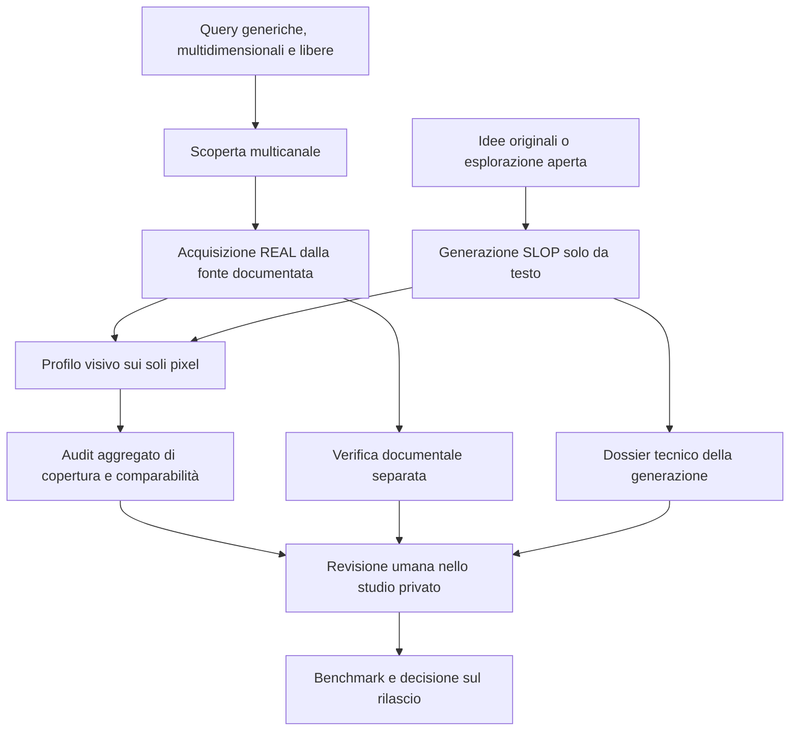

# Protocollo editoriale multidimensionale

Il [pilota rapido del 2026-11-03](benchmark-editoriale-v2-pilota-2026-11-03.md)
usa chiamate sincrone per esplicita richiesta del proprietario. I relativi dossier
riportano `transport: synchronous` e il vero `request_id`, senza inventare job
Batch. Il motore Batch rifiuta di riprendere un checkpoint sincrono. Nessun cambio
automatico di trasporto o modello; l'esecutore sincrono del pilota è separato.

La v2 costruisce due popolazioni indipendenti e le confronta dopo la raccolta.
L'istruzione del proprietario successiva alla issue #34 esclude **ogni derivazione
SLOP da fotografie**, comprese fotografie di un corpus separato. Non esistono
reinterpretazione, image-to-image, editing parziale, descrizioni di fotografie
usate come prompt o abbinamenti REAL/SLOP. Le immagini storiche derivate non
entrano nel campione v2 e non vengono cancellate o riclassificate.

La specifica 1.0.0 e i dossier precedenti restano immutati. La v2 non importa
rubrica, soglia 65, graduatoria, motivo di dubbio, preferenze apprese, categorie
di acquisizione o difficoltà del vecchio sistema. Riusa soltanto trasporto Batch,
autenticazione, storage privato, ottimizzazione tecnica e ledger dei costi.

## Obiettivo e confine

Allenare osservazione analitica, resistenza a scorciatoie e consapevolezza
dell'incertezza. Origine sintetica, veridicità del racconto e intento ingannatorio
sono concetti distinti. REAL/AI rimangono le etichette tecniche; SLOP è il nome
pubblico di AI, senza giudizio morale.

- REAL: fotografia autentica documentata, senza alterazioni semantiche, con
  diritti verificati. La presenza in un archivio o una licenza non ne provano
  automaticamente l'autenticità.
- SLOP: generazione integralmente sintetica da prompt originale, con processo
  tracciato. Nessun input fotografico, riferimento, URL o fotografia descritta.
- Ibridi, generative fill, inserimenti/rimozioni e manipolazioni parziali sono
  esclusi dalle classi giocabili. Provenienza dubbia significa quarantena.
- Dipinti, locandine e riproduzioni non fotografiche non diventano REAL. Una
  fotografia autentica di un'opera può essere fotografica, ma richiede verifica
  distinta dei diritti sull'opera. Il catalogo storico si audita separatamente.

Consentiti: sviluppo e bilanciamento globali, orientamento EXIF, conversione,
compressione e ridimensionamento dell'intero fotogramma. Crop, restauro e
upscaling non sono ammessi automaticamente in questa versione: occorre una
successiva policy verificata, anche quando non sono generativi. Non si equipara
ogni intervento tecnico a una falsificazione. Interventi semantici o non
documentati non vengono classificati per supposizione.

## Architettura sperimentale

Componenti: `pipeline/v2/{discovery,protocol,engine,run,benchmark}.py`, contratto
condiviso `shared/editorial-v2.json`, validatori Python/TypeScript e API
`/api/admin/editorial/v2`. Il flusso AI accetta esclusivamente un piano autonomo;
il flusso REAL accetta un manifest fotografico documentale. Non esiste un lotto
unico da dividere a metà. Possono avere dimensioni e tempi diversi.

## Scoperta REAL

La scoperta prevista parte da keyword su motori di ricerca per immagini senza
vincolo a un archivio. La verifica e l'acquisizione avvengono successivamente
sulla fonte documentata. Il collector attuale usa API di archivi: è un canale
aggiuntivo e non implementa ancora adattatori generalisti. Nel pilota rapido
la ricerca connessa consente una verifica manuale di questo passaggio.

Il pianificatore riproducibile combina materiali, processi, relazioni, ambienti
e tecniche. Riserva un terzo degli slot a query libere fornite da una fase LLM
indipendente; il resto include query generiche e combinatorie. Questa ripartizione
riguarda l'esplorazione del motore, non quote editoriali di soggetti o classi.
L'input delle query libere registra `generator`; `EXPLORATION_INSTRUCTIONS`
fornisce le istruzioni neutrali da usare con il modello scelto. L'esempio nel
repository è redatto manualmente e non viene presentato come output LLM reale.
Il runner non avvia inferenze per creare queste query in modo implicito.

Ogni query viene inviata agli stessi motori configurati per permettere confronti
a risultati esaminati e costo comparabili. Le categorie non sono un parametro
di selezione: si possono annotare successivamente come multi-etichette libere.
Non esistono query obbligatorie `unusual ...`, né filtri basati sulla sorpresa.

Sono riusati i connettori ufficiali Commons, Openverse e archivistici.
Un motore di scoperta generalista deve essere un adattatore esplicitamente
configurato; i suoi risultati non autorizzano il download o l'etichetta REAL.
Brave e un provider compatibile con Google Images sono opzioni da confrontare
nel benchmark dopo verifica di termini, costi e condizioni. Nessuno scraping o
servizio a pagamento viene attivato. Gli host di download sono espliciti e i
redirect sono controllati dall'acquisitore esistente.

`collection.sqlite` conserva identità e URL, SHA degli originali e dHash.
Si riusano deduplica e conservazione di evidenze grezze e licenze canoniche senza
cambiarne versione o giurisdizione. Ogni query registra nuovi candidati, risultati
esaminati, chiamate e campi per costo, approvazioni documentali e novità visiva.
Valori non misurati restano `null`, mai zero inventato. La resa non annulla la
riserva esplorativa. Le quasi somiglianze richiedono esame, non sono una prova
d'identità o un motivo per eliminare automaticamente un'immagine eccezionale.

## Generazione SLOP originale

Il piano ha solo `version`, `independent: true`, `ideas`. Ogni idea ha `id`,
`mode`, `idea`, `prompt`. Le modalità sono `original` e `open`: un'idea autonoma
sviluppata oppure un invito meno prescrittivo all'esplorazione del generatore.
Non si richiedono anomalie, bellezza, finitura perfetta o stranezza. Scene
quotidiane, complesse, astratte nel soggetto e texture sono tutte esplorabili
entro il linguaggio fotografico.

Il contratto rifiuta campi aggiuntivi, riferimenti e URL nei prompt. La richiesta
immagine contiene solo modello, prompt, `n=1`, dimensione e qualità, sull'endpoint
`/v1/images/generations`. Nessun upload fotografico né `/images/edits`.
La conformità strutturale non può provare che un autore non abbia copiato una
descrizione esterna: l'indipendenza dell'ideazione va verificata anche in revisione.

Un output per idea nel primo studio; nessuna rigenerazione automatica. Scarti,
errori e file prodotti restano nei checkpoint privati. Modello, parametri, prompt
esatto, idea, modalità, timestamp, job, custom ID, richiesta, originale e derivato
sono conservati. Più modelli sono confrontabili mediante run distinti con budget
espliciti; non viene imposto né cambiato implicitamente il modello.

## Profilo visivo e ammissibilità

Il VLM riceve esclusivamente la rubrica v2 e i pixel, con contesto vuoto.
Non riceve origine, autore, fonte, titolo, prompt o giudizi documentali.
L'autenticità non viene inferita dalla risposta del VLM.

Il contratto descrive composizione e inquadratura; densità e occlusioni;
relazioni, contatti, ombre, riflessi e geometria osservabili; colore, luce,
contrasto, saturazione, nitidezza, rumore e profondità di campo; linguaggio e
contenuti multi-etichetta; ordinarietà, sorpresa e plausibilità **separate**.
I valori non valutabili possono essere `null`. Gli attributi diagnostici sono
versionabili, non categorie di ammissione o confini per la scoperta.

`usable` riguarda la fruibilità tecnica, `photographic` il linguaggio visivo.
Nessun punteggio medio o soglia di sorpresa. Un'immagine ordinaria senza soggetto
dominante è un caso positivo di test. Osservazioni e limiti della lettura devono
essere espliciti. Provenienza e diritti restano un controllo separato.

Originale intatto e derivato dell'intero fotogramma WebP q85, lato massimo 1024,
con medesima funzione per entrambe le classi: è l'anteprima di acquisizione
conservata con il profilo originale, non uno standard sufficiente per il gioco.

Il pilota aggiunge varianti di revisione **1024×1024, RGB, WebP q85** mediante
`pipeline.v2.presentation`. Si parte dagli originali, si applica l'orientamento,
un ritaglio centrale e lo stesso ridimensionamento per entrambe le origini.
Non si deformano i pixel né si aggiungono bordi. Coordinate sull'immagine orientata,
area conservata, eventuale ingrandimento e hash sono registrati in `variants.json`.
Gli originali e i vecchi dossier restano intatti; i vecchi profili non si applicano
ai nuovi pixel. Tutte le varianti hanno revisione pendente e profilo nullo.
Prima dell'uso verificare significato del ritaglio, qualità e crediti e ricalcolare
il profilo sulla variante effettiva. Non si ritagliano crediti o watermark
obbligatori: l'immagine incompatibile resta fuori dalla pubblicazione. Questa
esportazione locale non modifica approvazioni, R2 o catalogo e non chiama API.

Il proprietario ha confermato 1024×1024 come unico formato finale v2: il comando
di presentazione rifiuta altri formati. Per le prossime SLOP usare generazione
nativa quadrata; i formati di generazione storici restano nei dossier del pilota.
Il ritaglio attuale è geometrico e centrale: non riconosce soggetti o indizi.
La revisione confronta il fotogramma completo e può richiedere un'altra posizione
del quadrato quando taglia elementi essenziali o altera il significato della scena.

## D1, R2, costi e recupero

Migrazione additiva **0013**: `editorial_v2_runs`, prenotazioni, candidate e
revisioni. Nessuna modifica alle tabelle storiche, sessioni, immagini approvate
o pubblicazioni. Le candidate v2 non sono righe di `images`: neppure una loro
approvazione può renderle giocabili attraverso la pubblicazione legacy.

Storage privato `QUARANTINE/editorial-v2/<run>/<sha256>`, manifest dei file e
checksum verificati; nessun nuovo bucket. API e anteprime passano dall'autenticazione
admin esistente. Le route non accedono al nuovo schema quando il gate è assente,
quindi un Worker con database non ancora migrato conserva il comportamento v1.

Checkpoint con lease di 15 minuti e revisione CAS; configurazione e input sono
immutabili. Dossier originali e decisioni umane sono conservati separatamente.
Un run concluso non è modificabile via checkpoint. Recupero idempotente in un
workspace nuovo, riconciliazione degli invii incerti e nessun retry pagato implicito.
Le prenotazioni atomiche alimentano il ledger comune `editorial_usage` con run ID
prefissati `v2-`. Tetti per run, giorno e cumulativo e limiti di chiamate sono
applicati server-side; cambiare run non ripristina il budget. Timeout e annullamenti
non producono rimborsi presunti. Le stime non sono fatture o tetti dell'account.

Nessun modello, prezzo o budget è ereditato dalla v1. Modelli e prezzi v2 sono
espliciti, con zero/default disabilitato. Il client richiede `--start --execute`
e `ENABLE_EDITORIAL_V2_PAID=true`; il Worker richiede sia
`ENABLE_EDITORIAL_V2_EXPERIMENTS=true` sia il gate pagato. Nessun flag viene
impostato da questa modifica, nessun cron v2 viene creato. Una fase Batch può
richiedere fino a 24h; i tick terminano senza attese lunghe.

## Revisione e feedback

`/admin/editorial-v2` consente immagine, profilo, verifica del dossier e della
spiegazione, Approva/Rifiuta per lo studio ed esportazione del campione.
Approvare richiede origine verificata, diritti, archivio integro e conferma umana.
Ibridi, manipolazioni semantiche, contenuti REAL non fotografici e casi incerti
sono bloccati. Le revisioni hanno controllo di concorrenza e audit append-only.

Il feedback distingue `observations`, `misleading_assumptions`, `uncertainty` e
`origin_evidence_ids`. Questi ultimi devono riferirsi a evidenze del dossier.
Il testo iniziale riporta osservazioni del profilo e una dichiarazione esplicita
d'incertezza; non afferma di aver trovato segni di AI. Il revisore deve controllare
che osservazioni ed evidenze siano vere: la validazione dello schema non è una
verifica fattuale automatica. Non si assegnano livelli di difficoltà.

Una licenza non ancora stabilita è registrata come `license_url: null`: permette
l'archiviazione privata ma blocca l'approvazione con `license_unresolved`. Il
pilota non attribuisce automaticamente licenze agli output generati. Output e
reasoning del valutatore hanno limiti espliciti congelati nella configurazione;
il default storico di 4000 token resta compatibile con i checkpoint esistenti.

La pagina Informazioni spiega REAL, SLOP, esclusione degli ibridi e limiti dei pixel,
con un link prima del gioco e richiamo persistente nel sito. La demo conserva la
dichiarazione esplicita di illustrazioni ed etichette simulate.

## Benchmark e rilascio

[Piano, comandi, misure e limiti](benchmark-editoriale-v2.0.0.md). Il software
produce un campione fixture da 120 elementi e report riproducibili; non è un
campione fotografico né una verifica educativa con persone. Lo studio reale
100–200 candidate, confronto motori a budget comparabile, revisione documentale
e test di trasferimento restano necessari prima dell'attivazione.

La v2 **non espone un endpoint di pubblicazione**. L'abilitazione dello studio
privato non abilita il catalogo. Dopo benchmark e revisione servirà un rilascio
dedicato e approvato per trasferire candidate idonee al catalogo, conservando
pubblicazione atomica 50/50, monete indipendenti per round, capacità/preflight,
sicurezza, attribuzioni e segretezza dei payload. Nessuna sequenza rigida o coppia
REAL/SLOP verrà introdotta. Questi comportamenti del gioco non sono modificati.

Rollback dello studio: chiudere i due gate e interrompere nuovi invii; controllare
o annullare i job già inoltrati con lo stesso run ID prima di chiudere l'accesso
all'archivio. Non eliminare tabelle, file, ledger o vecchi asset. Nessun rollback
del catalogo è necessario perché lo studio non lo modifica.
