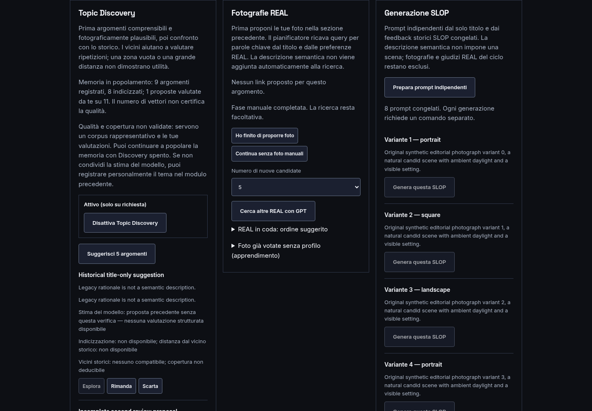
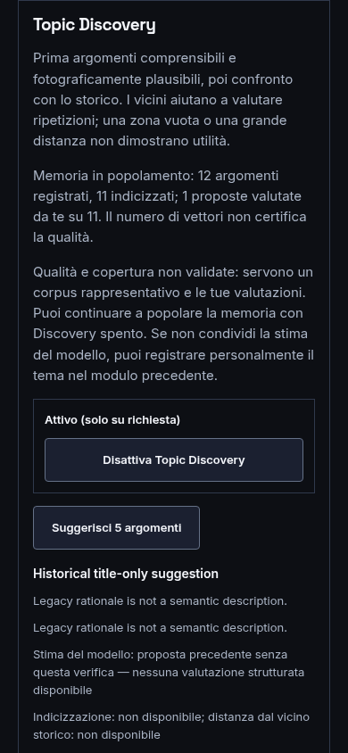
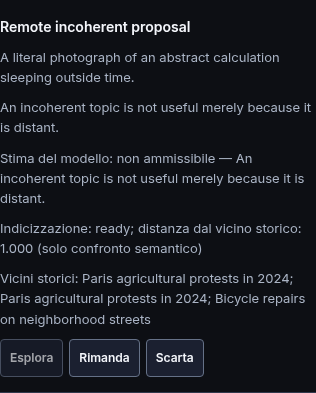

# Verifica della scoperta prudente — 1.0.0

Aggiornato: 2026-11-08T02:36:00Z. Base main `ff11c3d`; decisione corrente
dell'owner successiva alla #64. App 0.18.0, contratti 10.0.0, schema additivo 0025.

## Comportamento e limiti

La prima chiamata propone argomenti testuali con stime strutturate di coerenza,
specificità e plausibilità fotografica. Una stima negativa/incompleta in questa
fase non avvia embedding. La seconda chiamata già prevista controlla ammissibilità
e duplicati dopo il confronto semantico. Gli esiti del modello rimangono separati
dai voti dell'owner; la registrazione manuale di un tema resta disponibile anche
quando l'owner non condivide la stima automatica.

Nessuna ricerca di vettori arbitrari, riempimento di regioni vuote, ordinamento per
massima distanza o percentuale di qualità/novità. La distanza dal vicino storico è
un dato secondario; i vicini dello stesso lotto non diventano copertura storica.
I contatori non certificano la rappresentatività del corpus. Utilità e copertura
restano da valutare dopo il popolamento e con giudizi reali dell'owner.

Il nuovo registro del lotto protegge replay e concorrenza prima delle chiamate.
Le valutazioni sono persistenti; le escluse non producono falsi rifiuti umani.
Un eventuale vettore già prodotto prima della seconda esclusione resta nell'audit,
fuori dal corpus usato per i successivi vicini. Le tabelle preesistenti non vengono
ricostruite dalla migrazione 0025.

Il ramo REAL continua a pianificare keyword dal titolo e dalle preferenze REAL.
Il ramo SLOP mantiene titolo e feedback storici congelati prima delle REAL.
Descrizioni confermate o modificate non entrano automaticamente in questi payload.
Il controllo separato di pertinenza continua a usare la descrizione come prima.

## Verifiche riproducibili

- Lint, 32 file TypeScript e 258 test Python: PASS.
- Build TypeScript/Vite e `deploy:check`: PASS. Resta l'avviso preesistente sul
  bundle di similarità, senza nuove dipendenze.
- Migrazione 0025 e seed su D1 locale, `dry-run`: PASS.
- Worker/D1/R2 locali con provider simulati e browser desktop 1440×1000/mobile
  390×844: PASS. Comprende ancora l'intero flusso di curatela fino alla
  pubblicazione bilanciata di sole fixture locali.
- Nuove regressioni: corpus inizialmente vuoto, vicini dello stesso lotto,
  argomento escluso prima dell'embedding, proposta molto distante bocciata nella
  seconda revisione, episodio distinto con coseno alto, nessun voto umano
  inventato, risposta invalida/incerta bloccata, replay concorrenti e cache senza
  doppio addebito, pulsanti di accettazione bloccati e assenza di percentuali di qualità.
- Sentinella nella descrizione: presente negli embedding, assente nei payload
  di query REAL e preparazione SLOP. Modifica della descrizione: seed SLOP e hash
  congelati invariati. Nessun accesso a fotografie/voti REAL dal ramo SLOP.
- Integrazioni generali standard, Batch, v2, senza R2, REAL e ciclo eseguite
  sequenzialmente; risultati definitivi e CI riportati nella PR.

Queste prove verificano contratti e isolamento con API fittizie. **Non sono un
benchmark della qualità dei suggerimenti**, né attestano maturità dello spazio
semantico. Non sono state eseguite chiamate pagate, modifiche di gate/secret/budget,
migrazioni remote, cancellazioni di media, merge o deploy.

## Anteprime reali locali

Tutti i testi e vettori di queste anteprime provengono da fixture simulate.
Contratto e decisioni: [scoperta prudente 1.0.0](scoperta-argomenti-prudenti.v1.0.0.md).
