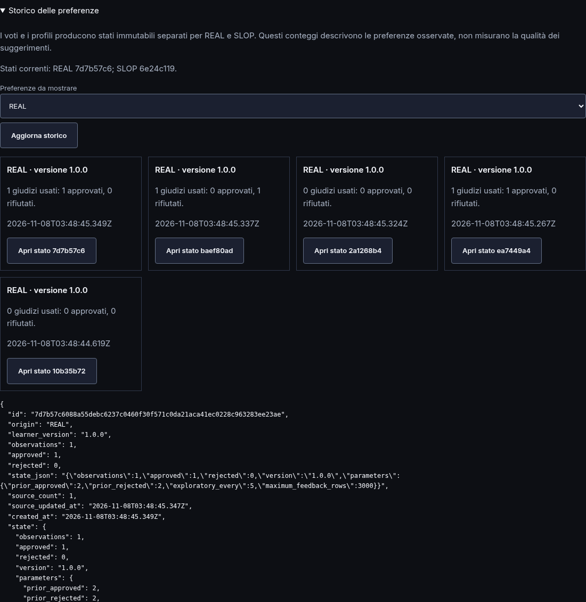
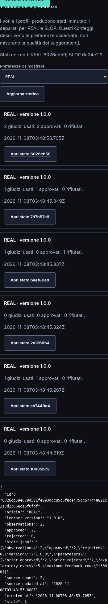
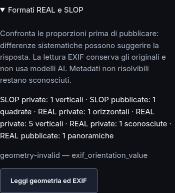

# Verifica snapshot e geometria — 1.0.0

Aggiornato: 2026-11-08T03:53:00Z. Base `0a595bf`, completamento #64 autorizzato
dall'owner. App 0.19.0; migrazione additiva 0026; contratti 11.0.0.

## Verifiche

- Lint, 34 file TypeScript, 258 test Python, build e deploy:check: PASS.
- Migrazione e seed sul solo D1 locale, dry-run: PASS.
- Worker/D1/R2 locali con provider fittizi: snapshot stabili su letture concorrenti,
  nuove versioni dopo correzioni di voto, esclusioni per diritti fuori dal gusto,
  dati storici immutabili e riferimenti espliciti allo stato usato dal ranking.
- Tracce di preferenze grandi e multibyte: ricostruzione esatta da righe JSON
  limitate a 500 kB; nessuna perdita di fonti per rientrare nel limite di una riga.
- Tutti gli orientamenti EXIF 1–8, byte order II/MM, JPEG con APP1 dopo SOF,
  metadata mancanti, offset/troncamenti, campi invalidi, EXIF multipli e limite
  di scansione; supporto degli stessi metadata in PNG/WebP. Originali invariati.
- Audit HTTP legato a SHA corrente, cache riusata, revisione/voto/metadata identici
  prima e dopo, rifiuto degli hash errati e conservazione degli esiti unknown.
- Chromium desktop 1440×1000 e mobile 390×844: cronologia con dettaglio e filtro
  REAL/SLOP, audit esplicito di due JPEG storici ruotati, flusso completo fino alla
  pubblicazione bilanciata di sole fixture locali, senza overflow o errori JS.
- Integrazioni standard, Batch, v2, senza R2, REAL e ciclo eseguite in sequenza.
  Esiti definitivi e CI sull'ultimo commit sono registrati nella PR.

Nessuna prova su fixture certifica qualità dei suggerimenti o apprendimento
misurato. Non sono state eseguite inferenze reali a pagamento.

## Primo rilascio della sessione

Main già approvato `0a595bf` è stato distribuito con le migrazioni 0024–0025:
versione Worker iniziale `23014609-477b-4e49-b30e-73b00af14962`. Backup D1,
restore/migrazioni provati in locale, backup R2 verificati; 64 tabelle precedenti
escluse le migrazioni e 419 oggetti R2 invariati. Codice/asset online confrontati
con i bundle locali, health 200, admin senza autenticazione 401. Il gioco resta demo.

La credenziale OpenAI è stata verificata tramite lettura dei modelli e configurata
come secret server, senza stamparne il valore. Le abilitazioni a pagamento restano
spente in attesa della scelta numerica del budget; il ledger era a 4,50 USD sul
precedente tetto di 5 USD. Ricevute e backup sono privati in `artifacts/release-next/`.

Per il secondo rilascio occorrono CI finale e prova del backup aggiornato con
0026 prima del codice nuovo. Gli originali eliminati nella pulizia precedente
rimangono eliminati: nessuna risincronizzazione o importazione è inclusa.

## Anteprime del vero admin locale

Tutti i dati e media delle anteprime sono fixture. Il collaudo autenticato è
locale: il token admin dell'app di produzione non è disponibile nel runtime.
Contratto: [snapshot e geometria 1.0.0](snapshot-preferenze-geometria.v1.0.0.md).
